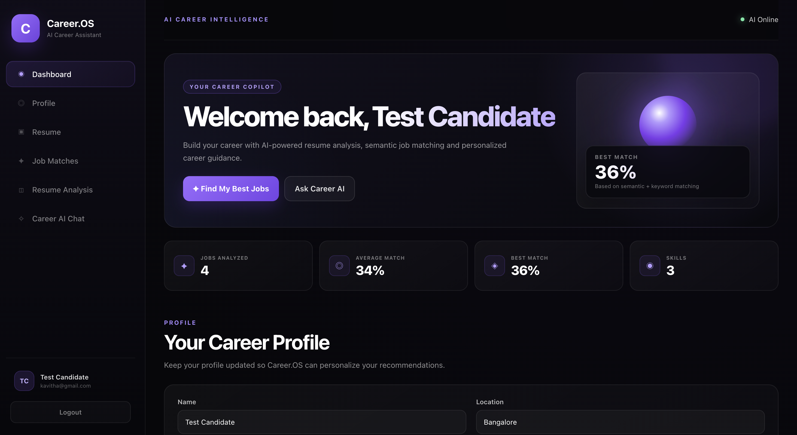
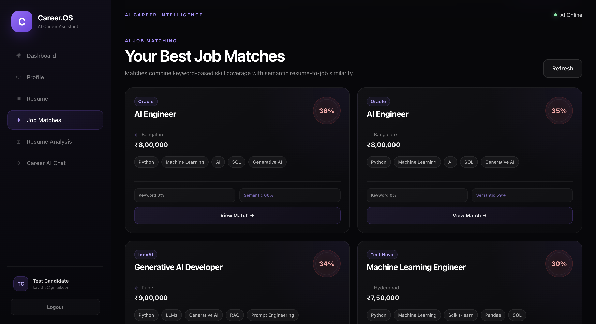
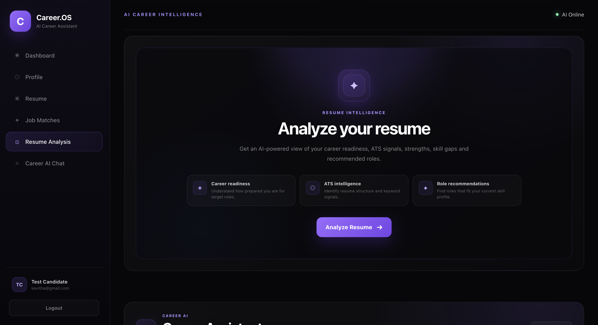
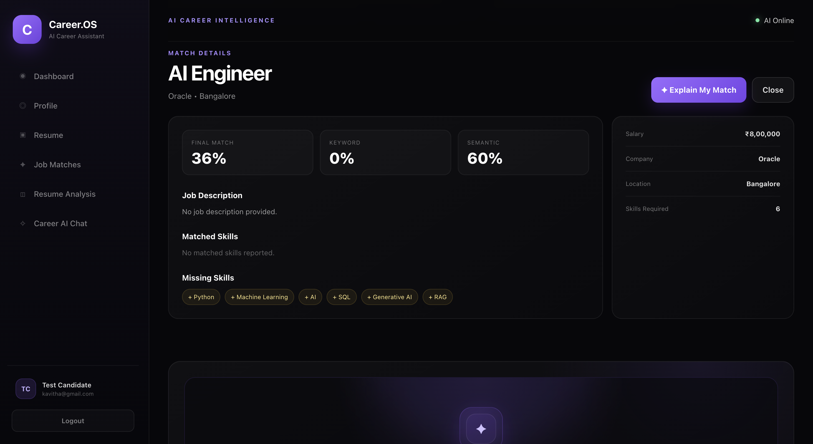
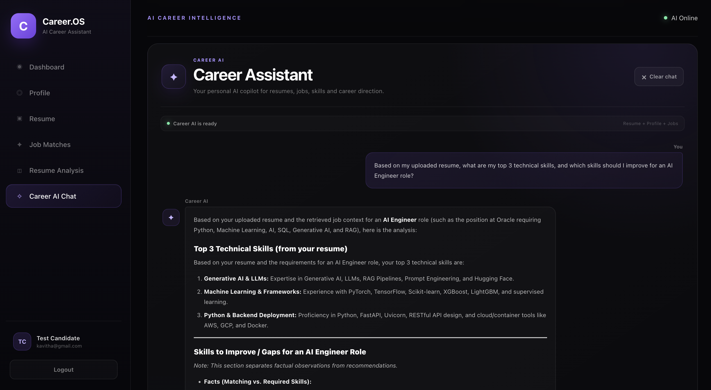
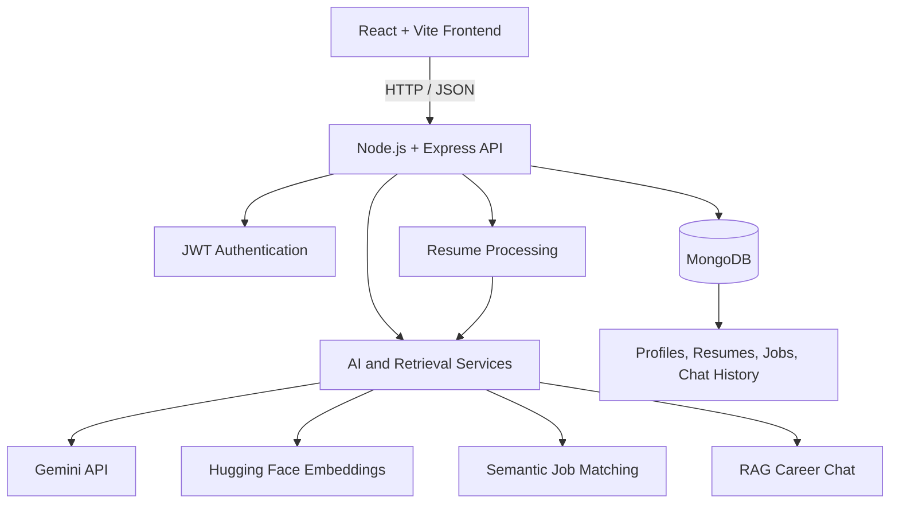

# Career.OS — AI Career Assistant

An AI-powered career platform that helps candidates analyze resumes, discover relevant jobs, understand job compatibility, and receive personalized career guidance.

## Screenshots

### 1. Dashboard



### 2. AI-Powered Job Matches



### 3. Resume Analysis



### 4. Explain My Match



### 5. Career AI Chat



## Features

- User registration, login, and JWT authentication
- Career profile creation and persistence
- PDF resume upload and text extraction
- AI-powered resume analysis and recommendations
- Keyword-based and semantic job matching
- Explain My Match with AI-generated job-fit insights
- RAG-powered Career AI Chat
- Persistent chat history separated by account
- MongoDB-backed application data

## Tech Stack

| Layer | Technologies |
|---|---|
| Frontend | React, Vite, JavaScript, CSS |
| Backend | Node.js, Express.js |
| Database | MongoDB |
| Authentication | JWT, bcrypt |
| Generative AI | Google Gemini API |
| Embeddings | Hugging Face Transformers |
| AI Retrieval | RAG, embeddings, cosine similarity |
| Document Processing | PDF parsing |
| Version Control | Git, GitHub |

## Architecture



## Project Structure

```text
ai-career-assitant/
├── backend/
│   ├── middleware/
│   ├── routes/
│   ├── services/
│   ├── server.js
│   └── .env.example
├── frontend/
│   ├── public/
│   ├── src/
│   │   ├── components/
│   │   └── utils/
│   └── .env.example
├── docs/
│   └── screenshots/
│       ├── dashboard.png
│       ├── job-matches.png
│       ├── resume-analysis.png
│       ├── explain-match.png
│       └── career-chat.png
├── .gitignore
└── README.md
```

## Getting Started

### Prerequisites

- Node.js and npm
- MongoDB database
- Google Gemini API key for Gemini-powered functionality

### 1. Configure and start the backend

```bash
cd backend
npm install
cp .env.example .env
```

Configure `backend/.env` with your own credentials:

```dotenv
MONGO_URI=your_mongodb_connection_string
GEMINI_API_KEY=your_gemini_api_key
JWT_SECRET=your_long_random_secret
PORT=5000
```

Start the backend:

```bash
node server.js
```

### 2. Configure and start the frontend

Open a second terminal:

```bash
cd frontend
npm install
cp .env.example .env
```

Set the frontend API URL in `frontend/.env`:

```dotenv
VITE_API_URL=http://localhost:5000
```

Start the frontend:

```bash
npm run dev
```

Open the local URL shown by Vite.

### 3. Build for production

From the frontend directory:

```bash
npm run build
```

The generated production assets are placed in `frontend/dist/`.

## Testing

The following features have been manually tested during development:

- Registration, login, logout, and re-login
- Authentication-protected API endpoints
- Profile persistence
- PDF resume upload and persistence
- AI resume analysis
- Job matching and Explain My Match
- Career AI Chat and persistent history
- Separate chat history across accounts

The frontend production build and backend JavaScript syntax checks have also passed locally.

These checks do not replace a complete production security audit or automated end-to-end test suite.

## Security

- Keep real environment files and credentials out of Git.
- Never publish MongoDB credentials, Gemini API keys, or JWT secrets.
- Keep personal resumes and uploaded documents out of the repository.
- Enforce authentication and user-specific authorization on private endpoints.
- Configure production CORS, HTTPS, upload validation, and rate limiting before public release.

## Future Improvements

- Production deployment and monitoring
- Automated unit and integration tests
- CI/CD automation
- Additional security and performance testing

## Project Status

Career.OS is a working full-stack AI project under active development. Core features have been manually tested locally. Production security hardening and deployment remain to be completed.

## License

A license has not yet been selected.